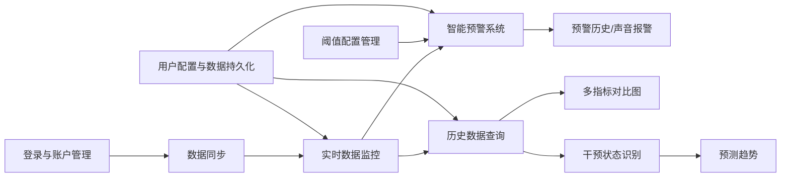
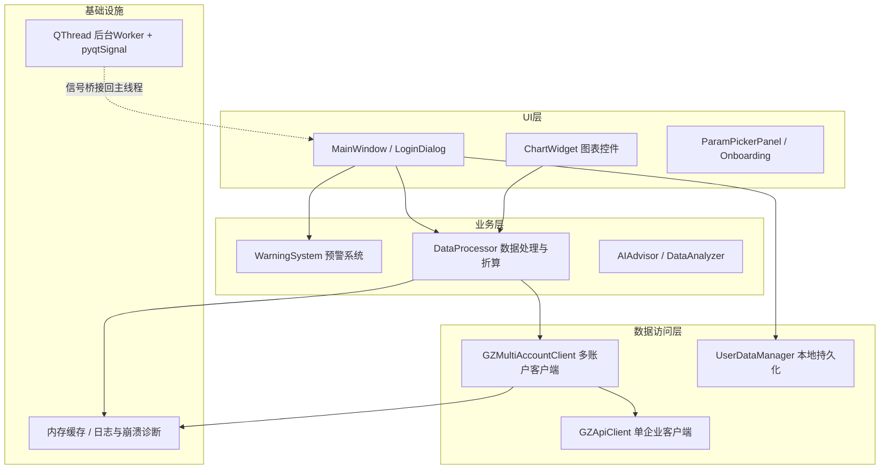
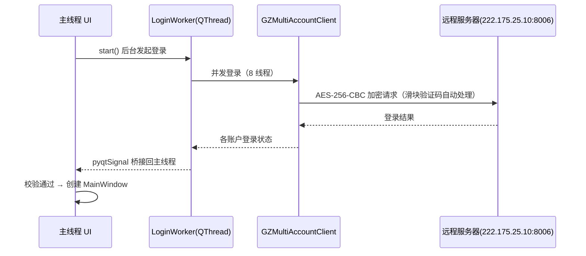
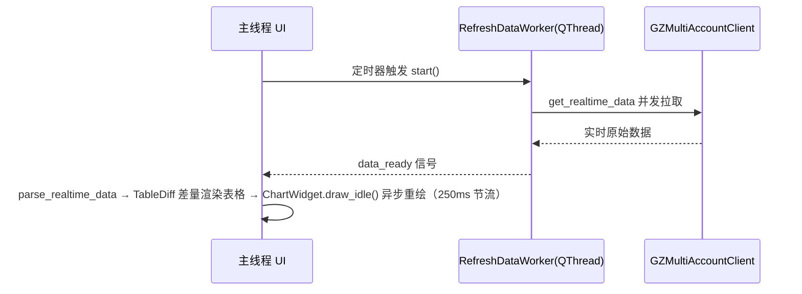
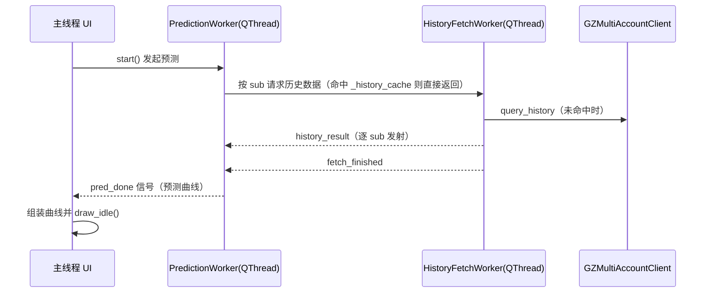

# GZ 安环监测系统（GZ_Monitor）软件开发说明书

> **适用版本**：GZ_Monitor v5.81（Windows 桌面 exe，单文件分发）
> **交付形态**：`dist/GZ_Monitor_v5.81_Win7.exe`（约 70 MB）
> **编写日期**：2026-11-11（v1.1）
> **读者对象**：开发团队、运维人员、客户项目干系人
> **配套文档**：《数据逻辑说明》（docs/数据逻辑说明.md）——数据单位、换算、聚合与判定的口径基准

---

## 目录

1. [项目概述](#第-1-章-项目概述)
2. [功能需求](#第-2-章-功能需求)
3. [非功能需求](#第-3-章-非功能需求)
4. [技术架构](#第-4-章-技术架构)
5. [开发与部署流程](#第-5-章-开发与部署流程)
6. [上线与维护计划](#第-6-章-上线与维护计划)
7. [数据逻辑说明](#第-7-章-数据逻辑说明)
8. [附录](#第-8-章-附录)

---

# 第 1 章 项目概述

## 1.1 软件定位

**一句话定位**：GZ安环监测系统（GZ_Monitor）是面向环保监管场景的 Windows 桌面客户端，连接企业环保监测服务器（http://222.175.25.10:8006），为环保管理人员提供废水/废气排放口监测数据的实时展示、历史趋势、超限预警与预测趋势一体化服务。

**详细说明**：本软件为单文件 Windows 桌面应用（PyQt5 + matplotlib，PyInstaller 单文件打包，约 67MB），免安装、免部署服务器，运行后直接接入企业环保监测服务器。系统内置 5 家企业账户，支持多账户同时登录、统一监控，将分散的排放口数据汇聚到同一界面，帮助无技术背景的企业环保管理人员快速掌握排放状况。

## 1.2 主要目标

1. **多企业统一监控**：内置不少于 5 家企业账户（山东冠洲股份、冠洲鼎鑫板材、冠县恒润热电、冠县冠锌金属、聊城东舜涂料），支持多账户并发登录、统一查看。
2. **实时数据秒级可达**：实时表格按企业/排口分组展示废水、废气监测项，单次刷新 <50ms，刷新节流 250ms，界面流畅不卡顿。
3. **历史趋势可查可析**：支持分钟/小时/日/月多粒度查询，日/月/季/年数据由小时数据在客户端聚合，不依赖服务器计算能力。
4. **预警及时准确**：实现超限、连续同值、急剧变化三类检测，输出正常/黄/橙/红四级状态并支持声音报警，预警历史可追溯。
5. **运行稳定可靠**：启动时间 <3s、UI 阻塞 <100ms、内存 500MB 阈值触发 GC、崩溃自动落盘（crash.log + MiniDump）支撑远程诊断。

## 1.3 目标用户群体

| 用户群体 | 细分说明 | 核心诉求 |
| --- | --- | --- |
| 企业环保管理人员 | 负责企业环保设施运行与排放数据管理，无需技术背景 | 打开即用、实时掌握排放数据、超限第一时间知晓、历史可追溯、操作无需培训 |
| 环境监管部门查看人员 | 负责辖区企业排放核查的查看人员 | 多企业统一视角、数据可信可查、预警分级清晰、趋势可预测 |

## 1.4 解决的核心问题

**现状痛点**：
- 多企业排放数据分散在各平台，监管人员需逐个登录、逐个查看，效率低；
- 数据展示依赖专业工具，无技术背景人员难以直接使用；
- 超限依赖人工巡检发现，存在滞后，易错过处置窗口；
- 缺乏趋势预测手段，难以提前干预、防患未然。

**软件价值**：通过多账户统一登录、实时/历史/预测一体化界面、分级智能预警与 AI 建议助手，将"分散、滞后、难用"的监测数据转化为"统一、实时、可用"的管理抓手，支撑企业环保合规与监管核查。

---

# 第 2 章 功能需求

## 2.1 功能模块总览

| 模块名 | 职责 | 关联模块 |
| --- | --- | --- |
| 登录与账户管理 | 多企业账户登录、AES-256-CBC 加密、滑块验证码自动处理、并发登录 | 实时数据监控、用户配置与数据持久化 |
| 实时数据监控 | 实时表格按企业/排口分组展示废水/废气监测项，排放口列表切换 | 登录模块、数据同步、智能预警系统 |
| 历史数据查询 | 按排口/时间范围查询历史趋势，分钟/小时/日/月多粒度聚合 | 数据同步、多指标对比图、预测趋势 |
| 预测趋势 | 基于历史趋势识别干预状态并预测，小时/日均预测，预测与实测曲线叠加 | 历史数据查询、干预状态识别 |
| 多指标对比图 | 同排口多参数/同参数多排口对比，双 Y 轴、归一化、曲线显隐 | 历史数据查询、实时数据监控 |
| 智能预警系统 | 超限/连续同值/急剧变化检测，分级预警、声音报警、预警历史 | 实时数据监控、阈值配置管理 |
| 干预状态识别 | 自动识别干预状态与强度，AI 建议助手输出建议 | 预测趋势、历史数据查询 |
| 阈值配置管理 | 废气/废水各参数上下限阈值配置，JSON 持久化 | 智能预警系统 |
| 用户配置与数据持久化 | %APPDATA%/GZ_Monitor/ 下配置与数据文件管理 | 全部模块 |
| 首次使用引导 | onboarding 浮层引导核心操作 | 登录与账户管理 |
| 数据同步 | 本地缓存 24h 历史数据、后台线程异步取数、热电厂折算数据注入 | 实时数据监控、历史数据查询 |
| 异常记录（v5.69+） | 扫描近 24 小时数据，汇总超标/故障/停产/异常与预警，按企业/类型/时间查询导出 | 实时数据监控、数据同步 |
| 官网数据标记（v5.75+） | 只读展示官网「日常工作 → 数据标记」结果（已标记/待标记），软件内不提供标记操作 | 异常记录 |
| 官网日数据导入（v5.78+） | 解析官网导出的分钟/小时/日 Excel，排放量 t→kg，作为日排放量预测基准 | 预测趋势 |

## 2.2 各模块详细功能需求

### 2.2.1 登录与账户管理
- 内置 5 家企业账户，支持多账户并发登录、统一监控；
- 登录凭证经 AES-256-CBC 加密传输，滑块验证码自动处理；
- 登录失败可重试；登录流程后台线程化，不阻塞界面；
- 账户新增/管理受版本权限密码控制（VERSION2_ADD_PASS）。

### 2.2.2 实时数据监控
- 主窗口实时表格，按企业/排口分组展示监测项：非甲烷总烃、二氧化硫、氮氧化物、颗粒物、化学需氧量、pH 值、氨氮、流量等；
- 排放口列表可切换；表格差量更新（TableDiff），仅更新变化的单元格；
- 后台线程异步取数，刷新节流 250ms；数据本地缓存 24h。

### 2.2.3 历史数据查询
- 按排口、时间范围查询历史趋势；
- 支持分钟/小时/日/月多粒度；日/月/季/年数据由小时数据客户端聚合；
- 查询结果供多指标对比图、预测趋势模块复用。

### 2.2.4 预测趋势
- 预测算法基于历史趋势识别干预状态，支持小时/日均预测；
- 预测曲线与实测曲线叠加展示，标注置信度与预警状态；
- 按需预测并发受限（BoundedSemaphore(2)）；预测定时器 60s 与刷新定时器 1200s 错峰执行。
- **日排放量预测**（v5.47+）：按排口逐参数计算每日排放量（kg/天）并外推未来 N 天；
  - 历史基准 = 参与时段的日排放量算术平均值（详见第 7 章与《数据逻辑说明》）；
  - 基线方式可选：上一天 / 前 N 工作日 / 全部历史 / 自定义时段；
  - 数据来源优先级：官网导入日数据 → 服务端日数据（不可用）→ 小时数据客户端聚合；
  - 表格「历史基线」为未校准的纯日均，D+N 为叠加自学习校准后的预测值。

### 2.2.5 多指标对比图
- 支持"同排口多参数"与"同参数多排口"两种模式；
- 双 Y 轴、归一化展示，提供参数选择器与曲线显隐；
- 基于 matplotlib（Qt5Agg）绘制，draw_idle 异步重绘保证交互流畅。

### 2.2.6 智能预警系统
- 超限预警（依据阈值配置）、连续同值检测、急剧变化检测；
- 分级展示：正常/黄/橙/红；触发声音报警；
- 预警历史记录持久化，便于事后追溯。

### 2.2.7 干预状态识别
- 基于历史趋势自动识别干预状态与强度；
- AI 建议助手（ai_advisor.py）输出可读处置建议，辅助管理人员决策。

### 2.2.8 阈值配置管理
- 废气/废水各参数上下限阈值可配置；
- JSON 持久化（gz_thresholds.json），变更即时生效；
- 管理类操作受版本权限密码控制（VERSION3_MANAGE_PASS）。

### 2.2.9 用户配置与数据持久化
- 配置与数据统一存放于 %APPDATA%/GZ_Monitor/；
- 管理文件：user_config.json、accounts.json、monitor_data.json、app_info.json；
- 崩溃日志落盘 logs/crash.log；重启后恢复用户配置与账户信息。

### 2.2.10 首次使用引导
- 首次启动展示 onboarding 浮层引导，覆盖登录、实时监控、历史查询、预警查看等核心路径。

### 2.2.11 异常记录与官网标记
- 每 30 分钟（登录后 3 秒首次）扫描近 24 小时数据，按官方标记分类为 超标/故障/停产/异常；
- 按企业、类型、时间范围、处理状态（官网标记）筛选，支持 Excel/CSV 导出；
- 记录持久化于 `data/abnormal_records.json`，同一异常不重复入库；
- **只读原则**：标记状态取自官网「日常工作 → 数据标记」，软件内不提供标记/取消标记操作，
  避免与环保平台标记不一致（v5.75 起移除本地标记）；
- 页签标题显示未标记数量角标，日常在其他页签也能看到待处理数量。

### 2.2.12 数据同步
- 本地缓存 24h 历史数据，弱网/断网时优先使用缓存；
- 后台线程异步取数，并发线程上限 8，避免资源耗尽；
- 热电厂折算数据自动注入实时数据流。

## 2.3 模块间交互关系

**数据流（文字描述）**：
1. 登录与账户管理建立会话 → 数据同步（后台线程异步取数）→ 实时数据监控（实时表格）→ 智能预警系统（异常检测）→ 预警历史/声音报警落盘；
2. 实时数据监控/数据同步 → 历史数据查询（多粒度聚合）→ 多指标对比图、预测趋势；
3. 历史数据查询 → 干预状态识别 → 预测趋势（置信度/预警状态）；
4. 阈值配置管理 → 智能预警系统（检测依据）；用户配置与数据持久化 → 各模块（配置读写）。

**调用关系简图**：



---

# 第 3 章 非功能需求

## 3.1 性能指标

| 指标 | 目标值 | 说明 |
| --- | --- | --- |
| 启动时间 | <3s | 桌面应用冷启动目标 |
| UI 阻塞 | <100ms | 所有操作不得明显卡顿 |
| 实时表单次刷新 | <50ms | 后台取数 + 表格差量更新 |
| 刷新节流 | 250ms | 避免高频刷新耗尽资源 |
| 并发取数线程 | 8 线程 | 多账户/多排口并发取数上限 |
| 预测并发 | BoundedSemaphore(2) | 按需预测并发限制 |
| 定时器错峰 | 预测 60s / 数据刷新 1200s | 避免同时触发资源竞争 |
| 内存占用 | 500MB 阈值触发 GC | 超阈值主动回收 |
| 安装包体积 | 约 67MB 单文件 exe | PyInstaller --onefile 打包 |

## 3.2 安全性

- 登录凭证 AES-256-CBC 加密传输，避免明文泄露；
- 版本权限密码：VERSION2_ADD_PASS 控制账户新增、VERSION3_MANAGE_PASS 控制管理类操作；
- 登录失败提供重试，避免误操作导致会话中断；
- **现实约束说明**：本软件为本地 exe 客户端，凭证与权限密码最终存储于客户端内存/本地文件中，无法达到服务端同等防逆向强度；AES 密钥的保存与交换受客户端环境限制，属"传输加密 + 应用层权限控制"的现实安全边界。（建议/待定：如需更高强度，可引入服务端鉴权与密钥托管。）

## 3.3 可用性

- 面向无技术背景用户：界面以表格、图表为主，全程无命令行操作；
- 首次使用引导（onboarding 浮层）覆盖核心操作路径，降低上手成本；
- 状态栏展示数据生成时间，便于用户判断数据时效；
- 预警分级（正常/黄/橙/红）以颜色可视化呈现，理解成本低；
- 声音报警提示超限事件，无需持续盯屏。

## 3.4 可移植性

- 明确兼容 Windows 7 与 Windows 10；
- 配置与数据统一存放于 %APPDATA%/GZ_Monitor/，不依赖安装目录写权限；
- 单文件 exe 分发（dist/GZ_Monitor_v5.81_Win7.exe，约 70 MB），免安装、免依赖部署；
- 崩溃日志与 MiniDump 落盘 %APPDATA%/GZ_Monitor/logs/，便于跨机器收集诊断。

## 3.5 可扩展性

- 多账户可扩展：内置 5 家企业账户，可按权限密码扩展更多企业账户；
- 参数配置化：监测项与阈值通过配置文件（gz_thresholds.json 等）管理，新增参数无需改代码；
- 模块化架构：登录、监控、查询、预测、预警等模块职责清晰、通过信号/数据接口解耦，便于后续迭代。（建议/待定：可规划插件化扩展与服务器端能力建设。）

---

# 第 4 章 技术架构

## 4.1 系统架构模式

本系统采用**单进程、多线程、事件驱动**的桌面应用架构：

- **主线程（UI 线程）**：负责窗口绘制、事件循环与用户交互，只做"数据组装 + draw_idle()"，不执行网络请求与耗时计算，保证界面不卡顿。
- **后台 Worker 线程（QThread）**：登录、实时刷新、历史拉取、预测计算均在后台线程执行，通过 `pyqtSignal` 将结果桥接回主线程；线程间共享 `dict` 缓存（历史缓存、API 缓存），在 Python GIL 下"读多写少"场景安全。
- **事件驱动**：UI 事件（定时器、按钮）触发 Worker 启动，Worker 完成后发射信号，主线程槽函数更新界面，形成单向数据流。定时器错峰运行（数据刷新 1200s、预测 60s），避免并发冲突。

分层划分：

| 层次 | 职责 | 主要文件 |
| --- | --- | --- |
| UI 层 | 主窗体、登录对话框、图表、参数选择器、引导浮层 | main_window.py、chart_widget.py、pred_param_selector.py、onboarding.py |
| 业务层 | 数据处理与折算、预警检测、AI 建议、数据分析 | data_processor.py、warning_system.py、ai_advisor.py、data_analyzer.py |
| 数据访问层 | 远程 API 客户端、多账户并发、本地持久化 | api_client.py、multi_account_api.py、account_manager.py、user_data_manager.py |



## 4.2 技术选型原则

选型核心原则：**Win7 兼容、免部署、零新增重型依赖**。

| 组件 | 版本 | 选型理由 |
| --- | --- | --- |
| Python | 3.8.10 | 官方支持 Win7 的成熟版本线；构建机固定使用 C:\Python38\python.exe |
| PyQt5 | 5.15.9（Qt 5.15.2） | 稳定、LGPL 许可、原生支持 Win7、QThread 多线程模型成熟 |
| matplotlib | 3.7.5（Qt5Agg 后端） | 实时曲线、twinx 双 Y 轴、归一化开箱即用，避免自研绘图 |
| PyInstaller | 5.13.0 | `--onefile` 单文件打包，用户免装 Python，直接替换 exe 升级 |
| pycryptodome | 随构建锁定 | AES-256-CBC 通信加密，纯 Python 生态内解决 |

约束：不引入 OpenCV、pandas 等重型依赖，保证约 67MB 单文件体积与 Win7 启动速度；服务器地址、AES 密钥、预警阈值等均可在 config.py 集中配置。

## 4.3 模块划分

| 模块 | 职责 | 关键类/文件 |
| --- | --- | --- |
| 程序入口 | QApplication、Fusion 深色主题、登录对话框、崩溃兜底、日志落盘 | main.py（LoginWorker） |
| 主窗体与业务 | 主界面组织，预测/刷新/历史 Worker 协作 | main_window.py（MainWindow、LoginDialog、PredictionWorker、RefreshDataWorker） |
| 图表组件 | matplotlib 封装：多曲线图例显隐、双 Y 轴、归一化、draw_idle、hover | chart_widget.py（ChartWidget） |
| 历史数据拉取 | 后台按 sub 取历史、24h 缓存感知，逐 sub 发 history_result、结束发 fetch_finished | history_fetch_worker.py（HistoryFetchWorker） |
| 差量渲染 | 表格快照差量渲染、左右轴分类 | refresh_utils.py（TableDiff、classify_axis） |
| 多账户客户端 | 并发登录、并发取数（ThreadPoolExecutor 8 线程） | multi_account_api.py（GZMultiAccountClient） |
| 单企业客户端 | AES-256-CBC 加密、滑块验证码自动处理、login/get_realtime_data/get_minute_data_current_hour/query_history | api_client.py（GZApiClient） |
| 数据处理 | 实时数据解析、热电厂折算注入、预警等级 | data_processor.py（parse_realtime_data、merge_corrected_data_into_grouped、get_warning_level） |
| 预警系统 | 超限/同值/急剧变化检测、分级预警、声音报警、预警历史 | warning_system.py（WarningSystem） |
| 参数选择器 | 分类导航、搜索、多选 | pred_param_selector.py（ParamPickerPanel） |
| AI 建议 | 干预状态识别并输出建议 | ai_advisor.py |
| 数据分析 | 历史数据分析 | data_analyzer.py / data_analysis_window.py |
| 配置中心 | 服务器地址、AES 密钥、内置账户、阈值、参数映射、可调常量 | config.py（FIG_DPI=80、SERIES_CAP=12、HISTORY_TTL=86400、THROTTLE_MS=250、HISTORY_INDEX=1、RIGHT_AXIS_PARAMS） |
| 账户与持久化 | 账户管理、用户配置/数据 JSON 读写 | account_manager.py / user_data_manager.py |
| 首次引导 | 首次使用引导浮层 | onboarding.py |

## 4.4 核心流程

**（1）登录流程**（v5.38 起后台化）



**（2）实时刷新流程**（数据刷新定时器 1200s 触发，预测定时器 60s 独立触发）



**（3）预测流程**（后台线程 + 24h 历史缓存）



共同原则：主线程不做网络与计算；在途 Worker 引用由 dict 保持；closeEvent 统一 `quit()+wait(3000)` 退出，杜绝 "Destroyed while thread is still running"。

## 4.5 数据存储方案

| 存储内容 | 位置 | 格式 | 生命周期/说明 |
| --- | --- | --- | --- |
| 用户配置 | %APPDATA%\GZ_Monitor\user_config.json | JSON | 长期，升级 exe 不受影响 |
| 账户列表 | %APPDATA%\GZ_Monitor\accounts.json | JSON | 长期，账户管理模块维护 |
| 监测数据 | %APPDATA%\GZ_Monitor\monitor_data.json | JSON | 长期，本地业务数据 |
| 应用信息 | %APPDATA%\GZ_Monitor\app_info.json | JSON | 长期，版本/状态信息 |
| 预警阈值 | 项目根 gz_thresholds.json | JSON | 随版本发布，可配置 |
| 历史数据缓存 | 内存 dict `_history_cache` | 内存 | TTL 24h（HISTORY_TTL=86400），key=(subid, subtype_code, codes, start, end, index, use_corrected) |
| API 数据缓存 | 内存 dict `_api_data_cache` | 内存 | TTL 60s，防高频请求 |
| 崩溃日志 | %APPDATA%\GZ_Monitor\logs\crash.log | 文本 | 追加写入，运维收集 |
| 崩溃转储 | %APPDATA%\GZ_Monitor\logs\crash_\<pid\>_\<ts\>.dmp | MiniDump | 按需收集，定位原生崩溃 |

云端：远程环保监测服务器 http://222.175.25.10:8006 为唯一数据源，客户端只读拉取，本地不产生数据库。

## 4.6 打包分发方式

- **打包工具**：PyInstaller 5.13.0，`--onefile --console=False`，产物为单文件 `dist/GZ_Monitor_v5.81_Win7.exe`（约 70MB）。
- **spec 管理**：构建目录 `dist/GZ_Monitor_v5.81_onefile.spec`；hiddenimports 显式列出 config/multi_account_api/data_processor/history_fetch_worker/refresh_utils/account_manager/user_data_manager/pred_param_selector/onboarding/param_units/prediction_calibrator/web_daily_import，以及 xlrd/openpyxl（官网导出解析），确保 pycryptodome 等依赖打入包内。
- **版本命名**：v5.XX 递增；每次构建复制上一版 spec 改名并更新注释。
- **升级策略**：用户直接替换 exe 即完成升级；用户数据全部位于 %APPDATA%\GZ_Monitor\，与 exe 解耦，替换不丢失配置、账户与监测数据。

---

# 第 5 章 开发与部署流程

## 5.1 环境准备

| 项 | 要求 |
| --- | --- |
| 构建机系统 | Windows 7 兼容环境（或在 Win10 上以 Win7 兼容模式验证） |
| Python | 3.8.10（C:\Python38\python.exe，专用于 Win7 兼容，勿混用新版解释器） |
| 依赖 | PyQt5==5.15.9、matplotlib==3.7.5（Qt5Agg）、pycryptodome、PyInstaller==5.13.0 |

安装命令：`C:\Python38\python.exe -m pip install PyQt5==5.15.9 matplotlib==3.7.5 pycryptodome PyInstaller==5.13.0`

## 5.2 版本控制规范

- 仓库：git@github.com:junkechen/gz-monitor.git，主干分支 main。
- 提交信息规范：`v5.XX: 描述`，如 `v5.38: 登录后台线程化`。
- 每个发布版本打 tag（如 `v5.38`），与 exe 产物一一对应。
- 维护 `CHANGELOG.md`，按版本归档新增、修复与稳定性改动（v5.31-v5.38 稳定性演进逐版本记录）。

## 5.3 代码评审流程

建议以"变更自审 checklist"为基础，小步快跑，评审重点：

- [ ] 语法校验：`py_compile` 全部源文件通过；
- [ ] 冒烟测试：无头模式启动主窗口无异常；
- [ ] 回归测试：运行 tests/ 下既有用例；
- [ ] grep 检查：无旧版本类名/函数名残留引用；
- [ ] 诊断埋点保持完整：SetUnhandledExceptionFilter、qInstallMessageHandler、PRED_STEP 路径埋点不得删改；
- [ ] 线程安全：新增 QThread 注册引用、closeEvent 纳入 `quit()+wait()` 统一退出。

## 5.4 自动化测试策略

现有用例清单：

| 测试文件 | 用途 |
| --- | --- |
| smoke_main_window.py | 主窗口启动冒烟 |
| test_param_picker.py | 参数选择器交互 |
| test_pred_chart_draw.py | 预测曲线绘制 |
| test_onboarding.py | 首次引导浮层 |
| test_v533_async_refresh.py | 异步刷新回归 |
| test_v533_picker_chart_sync.py | 选择器与图表联动回归 |
| test_chart_splitter.py | 图表分割回归 |

执行方式：

- 无头测试：`QT_QPA_PLATFORM=offscreen C:\Python38\python.exe -m pytest tests/`（或逐个运行）；
- 语法校验：`C:\Python38\python.exe -m py_compile src/*.py`；
- 回归重点（Win7 兼容相关）：QThread 生命周期（不得出现 "Destroyed while thread is still running"）、draw_idle 异步重绘、无 Popup 顶层窗口泄漏、离屏渲染正常。

## 5.5 构建与打包

1. 复制上一版 spec：`dist/GZ_Monitor_v5.XX_onefile.spec` → 新版本名，更新版本注释；
2. 校验 hiddenimports 列表包含全部业务模块；
3. 构建：`C:\Python38\python.exe -m PyInstaller dist/GZ_Monitor_v5.81_onefile.spec`；
4. 产物验证：
   - 文件大小在 66-70MB 区间（当前约 67MB）；
   - 启动冒烟：双击 exe，确认登录窗口出现、Fusion 深色主题生效；
   - 确认 `console=False`（无黑色控制台窗口）。

## 5.6 测试环境与生产环境

- **同一构建流程产出**：测试与生产使用同一 spec 与命令，杜绝环境差异。
- **测试环境**：本机 Win10 开发机 + `QT_QPA_PLATFORM=offscreen` 无头测试 + smoke 冒烟。
- **生产环境**：用户 Win7/Win10 实机直接替换 exe 完成升级；替换前建议备份旧 exe 以便回退。
- **分发渠道**：按现有用户通道下发 exe 与版本说明（CHANGELOG 摘要），升级不影响 %APPDATA% 数据。

---

# 第 6 章 上线与维护计划

## 6.1 里程碑安排

| 阶段 | 内容 | 状态 |
| --- | --- | --- |
| v5.31 | 三层诊断体系落地（SetUnhandledExceptionFilter / qInstallMessageHandler / PRED_STEP 埋点） | 已达成 |
| v5.33 | 异步刷新、参数选择器与图表联动 | 已达成 |
| v5.31-v5.38 期间 | 图表分割、多账户并发取数、24h 历史缓存、250ms 节流 / draw_idle / TableDiff 差量渲染等性能与稳定性优化 | 已达成 |
| v5.38 | 登录后台线程化、QThread 生命周期加固（quit()+wait(3000)） | 已达成 |
| v5.39+ | 技术文档交付、评审闭环、回归基线固化 | 建议 |
| v6.x | 架构演进（QTableView/Model、服务端鉴权等） | 待定 |

## 6.2 验收标准

**功能验收**
- [ ] 登录（含滑块验证码自动处理）、实时刷新、历史查询、预测、预警、数据分析均正常；
- [ ] 多账户并发登录与取数结果正确。

**性能验收**
- [ ] 冷启动到登录窗口 < 3s；
- [ ] 常规 UI 操作响应 < 100ms（主线程无阻塞）；
- [ ] 实时刷新数据处理与渲染 < 50ms（在 250ms 节流窗口内）。

**稳定性验收**
- [ ] Win7、Win10 实机各连续运行 ≥ N 小时无崩溃、无 "Destroyed while thread is still running" qFatal；
- [ ] 日志目录无异常新增 crash.log / dmp。

**兼容性验收**
- [ ] Win7（含老 CPU 环境）可启动、可正常刷新；
- [ ] 单文件替换升级后，%APPDATA%\GZ_Monitor\ 配置与数据完整保留。

## 6.3 上线后运维监控

- **客户端日志收集**：定期回收 %APPDATA%\GZ_Monitor\logs\crash.log 与 crash_\<pid\>_\<ts\>.dmp，按 PID/时间戳定位崩溃现场；
- **版本确认**：通过主窗口状态栏显示的生成时间/版本号确认用户运行版本，避免反馈版本混淆；
- **用户反馈渠道**：沿用现有沟通通道（群/工单），收集问题时附版本号 + crash.log + 操作步骤；
- **告警关注**：重点跟踪启动失败、登录失败率上升、刷新超时等信号，及时回滚或发布补丁版本。

## 6.4 日志与错误收集机制

三层诊断体系（v5.31 起）：

1. **原生崩溃兜底**：`SetUnhandledExceptionFilter` 捕获段错误等原生异常，落盘 MiniDump（crash_\<pid\>_\<ts\>.dmp）；
2. **Qt 致命错误**：`qInstallMessageHandler` 拦截 qFatal（如线程销毁错误），由 `_write_crash_log` 写入 crash.log；
3. **业务路径埋点**：PRED_STEP 关键步骤埋点，配合状态栏生成时间还原操作路径。

日志位置：`%APPDATA%\GZ_Monitor\logs\`（crash.log 文本 + dmp 二进制）。

解析定位：先看 crash.log 的时间与消息类型，判断是原生崩溃还是 Qt 层错误；对应 dmp 用 WinDbg/VS 打开，结合 PRED_STEP 埋点与版本号还原现场。

## 6.5 后续迭代方向

以下均为**建议/待定**项，未在当前版本实现：

- 服务端鉴权与密钥托管（当前 AES 密钥在 config.py 内置，建议迁移至服务端下发/轮换）；
- 表格 QTableView/Model 化改造（当前 TableDiff 命令式渲染为控风险选择）；
- 插件化扩展（预警算法、预测算法可插拔）；
- 云同步多端（配置/阈值跨机器同步）；
- 预警消息推送（短信/邮件/企业微信，当前仅本机声音报警）；
- 更多预测算法与 AI 建议能力增强。

---

# 第 7 章 数据逻辑说明

本章给出系统内**数据从官网到界面的完整口径**，是开发、排障与业务核对的共同基准。
详细展开见配套文档 **[《数据逻辑说明》](数据逻辑说明.md)**。

## 7.1 数据链路

官网 Web6 → `GZApiClient`（登录/Session/参数） → `data_processor.py` / `param_units.py`
（单位换算、排放量、状态分类、预测） → 实时监控页 / 历史数据页 / 数据预测页 / 异常记录页。

## 7.2 必须统一的三条口径

| # | 规则 | 违反后果 |
|---|------|---------|
| 1 | 服务端「流量(m3)」在**所有粒度**下均为 **m³/h**；分钟数据须 ×1/60 | 分钟排放量高估约 60 倍 |
| 2 | **日排放量(t) = Σ 24 小时排放量(kg) ÷ 1000**（官网日导出单位是吨） | 差 1000 倍 |
| 3 | **小时排放量(kg) ≈ Σ 该小时 60 分钟排放量**（服务端按分钟积分） | 用「小时均值×流量」重算会低估 |

实测证据（官网导出，鼎鑫彩涂 1-3#，2026-11-02，非甲烷总烃）：
Σ60 分钟 = 0.227 ≈ 小时 0.228；Σ24 小时 = 9.569 ≈ 日 9.570 kg。

## 7.3 排放量计算与取值优先级

```
排放量(kg) = 浓度(mg/m³ 或 mg/L) × 流量(m³/h) × 小时数 ÷ 分母
    废气 ÷1e6 ／ 废水 ÷1e3 ；  小时数：分钟 1/60、小时 1、日 1
```

取值优先级（各模块一致）：
① 服务端行内排放量字段 → ② 小时聚合行 `emis_{code}`（Σ逐时） → ③ 公式换算。

浓度一律用**实测值**；折算值仅热电厂（`use_corrected`）在预测中使用。

## 7.4 关键口径约定

| 主题 | 约定 |
|---|---|
| 参数代码 | `data_processor.CODE_TO_NAME`；仅浓度类参数可算排放量 |
| 流量参数选取 | `pick_flow_code` 按 210→492→494→495 选**有值**者 |
| 日聚合字段 | `val_`=小时算术平均、`flowsum_`=Σ小时流量、`emis_`=Σ逐时排放量、`hours_`=有效小时数 |
| 历史基准 | **参与时段的日排放量算术平均**（未叠加自学习偏差）；预测值另含校准 |
| 基线模式 | auto=上一天+前10工作日组合；custom+时段=完整序列日均；prev_day / last_10_workdays / all_history |
| 数据缺失 | 整段窗口从未报送的参数不判缺失；突然缺数仍报（v5.72 起） |
| 官网标记 | `state_/status_` 即官网「数据标记」结果；软件内**只读**，不做本地标记（v5.75 起） |
| 官网日数据 | 客户端 `index=2` 恒返回空（258 次实证）；改用小时聚合或「导入官网日数据」 |

## 7.5 数据来源优先级（日排放量预测）

```
① 官网导入序列（≥3 天）→ 直接作为基准，标签「官网导入日均(N天)」
② index=2 日数据（不可用）
③ index=1 小时数据 → 客户端按日聚合（Σ逐时）
```

## 7.6 文档与代码对应

| 主题 | 代码位置 |
|---|---|
| 排放量换算 / 分母 / 单位归一 | `src/param_units.py` |
| 状态分类、参数表、基线计算 | `src/data_processor.py` |
| 小时→日聚合 | `src/main_window.py :: _aggregate_hour_rows_to_daily` |
| 官网导出解析与存储 | `src/web_daily_import.py` |
| 异常扫描与记录 | `src/abnormal_scanner.py` |

---

# 第 8 章 附录

## 8.1 版本演进要点（v5.39 → v5.80）

| 版本 | 内容 |
|---|---|
| v5.39~v5.46 | 文档交付、预测/预警框架成型 |
| v5.47~v5.55 | 日排放量预测、排放量单位纠正为 kg、预测自学习校准 |
| v5.56~v5.63 | 自定义基线时段、废气/废水显示参数、限值封顶与浓度反推 |
| v5.64~v5.68 | 日排放量表格列重构、版本检查、登录失败跳过 |
| v5.69~v5.72 | 异常记录页（超标/故障/停产/异常）、数据缺失误报修复 |
| v5.73~v5.75 | 异常处理状态（后改为只读官网标记）、页签角标 |
| v5.76~v5.78 | 历史基准口径对齐官网、导入官网日数据、日数据接口探测 |
| v5.79~v5.80 | 证实「日=Σ小时」、优先服务端小时排放量、分钟流量 ÷60 |
| v5.81 | 交付《软件开发说明书》v1.1 与《数据逻辑说明》 |

## 8.2 目录与文件索引

```
src/                    主程序与核心模块
├─ main.py              入口（含崩溃兜底、用户数据目录定位）
├─ main_window.py       主窗口与全部页签
├─ multi_account_api.py 登录/会话/历史与实时接口封装
├─ data_processor.py    参数表、状态分类、预测算法
├─ param_units.py       单位换算与排放量计算
├─ web_daily_import.py  官网导出解析与存储（v5.78+）
├─ abnormal_scanner.py  异常扫描与记录存储
├─ prediction_calibrator.py 预测自学习校准
tests/                  单元测试（18 个文件，随版本增补）
docs/                   本文档、数据逻辑说明、数据接口文档、系统设计
dist/                   打包产物与 spec
```

## 8.3 运行期数据位置

| 内容 | 位置 |
|---|---|
| 配置 / 阈值 / 自定义基线 | `%APPDATA%\GZ_Monitor\`（打包后）或 `data/`（源码运行） |
| 异常记录 | `data/abnormal_records.json` |
| 官网导入日数据 | `data/web_daily_import.json` |
| 预测自学习样本 | `data/pred_calibration.json` |
| 日志 | `%APPDATA%\GZ_Monitor\logs\`（含 history_debug.log 接口调试记录） |

## 8.4 术语表

| 术语 | 含义 |
|---|---|
| 折算值 | 按基准氧含量折算后的浓度（仅燃烧类/热电厂有值） |
| 期间累计流量 | 某时段内的累计体积（m³），排放量换算的流量依据 |
| m³/h 流量 | 服务端各粒度流量列的真实单位（瞬时或时段平均） |
| 排放量(kg) / 排放量(t) | 官网小时/分钟导出为 kg，日导出为 t（1 t = 1000 kg） |
| 官网标记 | 官网「日常工作 → 数据标记」写入的 state/status 标记 |
| 历史基准 | 参与时段的日排放量算术平均值（kg/天），用于外推起点 |

---

*文档版本：v1.1 ｜ 适用软件版本：GZ_Monitor v5.81 ｜ 配套文档：《数据逻辑说明》（docs/数据逻辑说明.md）、《数据接口文档》（docs/数据接口文档.md）*
